# Olá, eu sou a Cibelle Rodrigues! 👋 👩‍💻

**AI Engineer | Software Engineer | Ciência da Computação (UESC)**

Sou desenvolvedora Full-Stack e entusiasta de Inteligência Artificial, focada em construir soluções que resolvem problemas reais de negócio. Tenho experiência prática no desenvolvimento de **pipelines com LLMs (Gemini, Claude e Ollama)**, uso avançado de **Claude Code** para aceleração de desenvolvimento, técnicas de **Few-Shot Prompting**, avaliação de modelos e **Visão Computacional (YOLOv8)**. 

Acredito no poder de aliar código limpo a uma infraestrutura segura (modelos locais com Ollama e aplicações conteinerizadas com Docker) para escalar impacto com responsabilidade e "mentalidade de dona".

---

### 🚀 Principais Projetos (Destaques de IA)

*   🏋️‍♀️ **[TrainMe](https://github.com/CibelleSousa/trainme):** Agente de IA para progressão de treinos. Pipeline full-stack (FastAPI, React) que extrai dados estruturados de treinos escritos ou falados. Implementei um sistema de roteamento entre modelos em nuvem (Gemini, com 94% de acerto exato) e locais (Ollama Qwen3:8b), medindo em 52 exemplos que técnicas de *few-shot* elevaram a precisão local de 13% para 67%. [📄 Artigo](https://dev.to/cibellesousa/medindo-um-agente-de-treino-o-que-o-few-shot-fez-e-nao-fez-com-um-modelo-local-e-com-o-gemini-54a0) · [🤗 Dataset](https://huggingface.co/datasets/CibelleRodrigues/trainme-treino-ptbr)
*   🗺️ **[TuristAI](https://github.com/davidmarianosantos/turistai):** Solução de redirecionamento inteligente de fluxo turístico focado em segurança (HackTurismo). Liderei a ideação do produto e utilizei **Claude Code** para acelerar a entrega do painel web de gestão pública.
*   🏭 **[Hawkeye](https://github.com/davidmarianosantos/hawkeye-pcb-defect-detection):** Detecção de anomalias industriais (PCB) utilizando **Visão Computacional (YOLOv8)**. Atuei no *transfer learning*, nos testes de generalização e na identificação de viés (o modelo aprendeu a cor em vez da geometria dos defeitos), com análise de *overfitting* e validação do modelo.
*   🧩 **[Clarivida](https://github.com/CibelleSousa/clarivida-vidros):** Otimização espacial (corte 2D) desenvolvida com algoritmo de busca heurística híbrida (A-star) e back-end em Node.js.

---

### 🛠️ Tech Stack & Ferramentas

**Inteligência Artificial & Dados:** 

**Engenharia de Software:** 

---

### 📊 GitHub Stats

  
  &nbsp;
  

  

---
📫 **Contato:** [LinkedIn](https://www.linkedin.com/in/cibellerods) | cibelle.rodrigues@outlook.com
